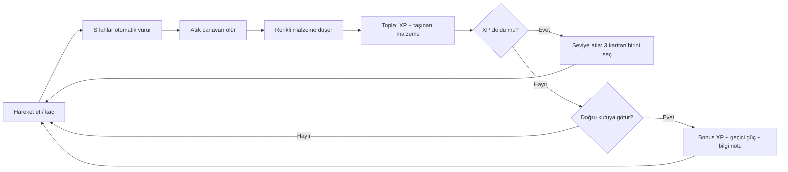

# Oynanış Döngüsü

## Mikro Döngü (saniyeler)
Kaç, düşmanlar saldırı menziline girsin, malzemeleri topla.

## Orta Döngü (30–60 sn)
Taşınan malzeme dolmaya başlar (her türden en fazla **30**). Ekrandaki renkli oklar kutuları gösterir. Riskli bir rota çizip **teslim et**, buff al. Kutu, teslimattan sonra başka bir yere taşınır.

## Makro Döngü (10 dk)
Build kurulur: 6 silah, 6 pasif, her biri 5 seviye. 5:00'te mini boss, 10:00'da final boss gelir.

## XP Eğrisi
`gereken = 5 + (sv-1)*8 + (sv-1)^1.9`. Autotest'te 2. dakikada sv 9, 5. dakikada sv 20, 10. dakikada sv 38 çıktı. İlk sürümde (`*6`, `^1.6`) 10. dakikada sv 55'e ulaşılıyordu ve her şey maksimuma çıkıyordu, bu yüzden eğri dikleştirildi.

İlgili notlar: [[Ayrıştırma Kutuları]], [[Dalga Zaman Çizelgesi]]
